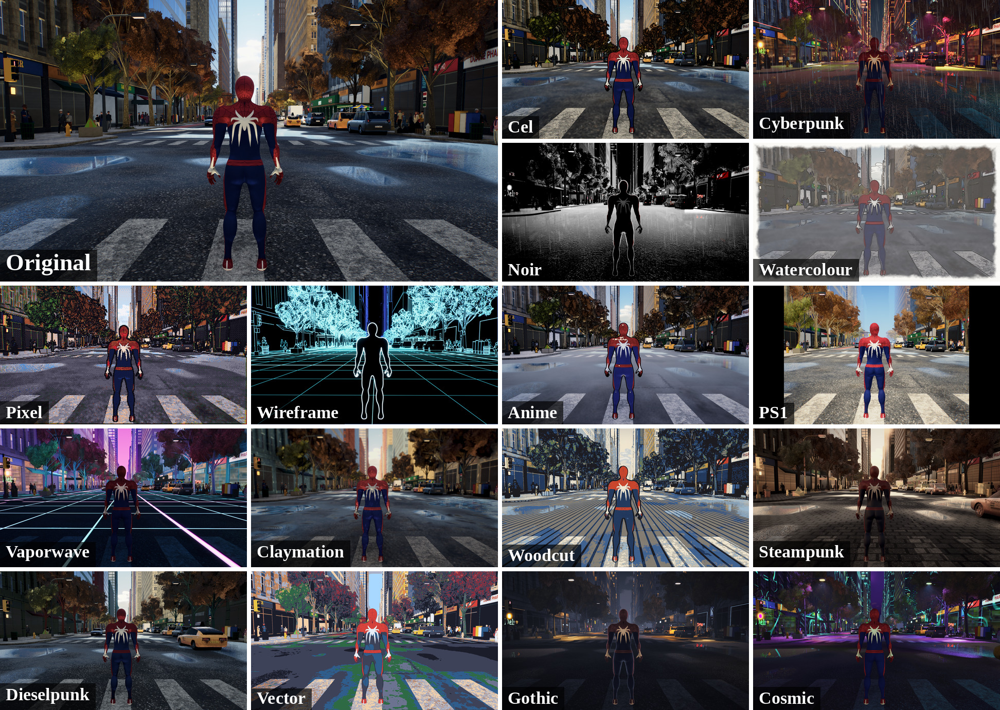

# StructRender

**Live demo: [structrender.vercel.app](https://structrender.vercel.app/)**

A Spider-Man web-swinging game that runs in the browser (Three.js, WebGL2), with
16 visual themes you can switch during play (hold **T**; press **H** in game for
the controls). Its source is the separate repository
[`Kabilash01/StructRender-Unity-`](https://github.com/Kabilash01/StructRender-Unity-).
The game draws its themes with its own rendering pipeline in the browser; the
web build does not run the neural renderer in this repository.



Unofficial fan project, not affiliated with Marvel, Disney, Sony or Insomniac
Games. Spider-Man is a trademark of its owners.

## This repository: neural rendering research

Engine-grounded neural game rendering. Godot owns world truth; a small neural
renderer owns appearance. The shipped renderer is a U-Net with two styles, oil
and watercolour, running live in the Godot game through TensorRT at about 44 fps
on an RTX 5060 Laptop GPU; the window-transformer design (StructFormer) never
beat it, even at 32x the data. **EPAM** (Engine-Keyed Persistent Appearance
Memory) — the headline research contribution — remembers a live entity's
generated appearance and retrieves it when that same entity re-enters view; on
this data it did not improve the output. Both negatives are reported as measured.

## Source of truth

The full architecture, locked decisions, module boundaries, milestone plan, and
evaluation protocol live in **[`docs/StructRender_KB.md`](docs/StructRender_KB.md)**.
Read the relevant section before working in any part of this repo. Behavioural
guidelines for contributors (human or agent) are in [`CLAUDE.md`](CLAUDE.md);
the Claude Code subagents are described in [`docs/AGENTS_README.md`](docs/AGENTS_README.md).

> The KB is referenced as `docs/StructRender_KB.md`, not the repo-root path
> shown in KB §8 — that is a deliberate, already-applied deviation so the
> `CLAUDE.md` reference resolves.

## Repository layout

Follows KB §8. Directories for later-milestone work exist as empty
`.gitkeep` placeholders; they are populated milestone by milestone per KB §10.

```
agent/          coding-agent workflow: specs, workflow docs, launch validators
configs/        YAML/TOML experiment configuration
game_project/   the Godot game (source of world truth)
data_pipeline/  recorder, structural exporters, entity lifecycle, validation
renderer/       StructFormer, baselines, temporal, EPAM, losses, training
inference/      ONNX export, TensorRT build, CUDA warp, C++ runtime
eval/           protocols, metrics (incl. RCS), plots, reports
tests/          unit / integration / e2e / fixtures
scripts/        one-command entry points (test, collect, train, eval, ...)
checkpoints/    model artifacts (git-ignored)
```

## Current status

**Complete.** M0–M10 done; see KB §10. Results, including the negative findings,
are in [`docs/REPORT.md`](docs/REPORT.md); the lab report is in
[`docs/lab_report/`](docs/lab_report/).

## Development

```bash
./scripts/test.sh        # run the full automated suite (one command; non-zero exit on failure)
```

Godot version is pinned in [`.godot-version`](.godot-version).

## Third-party models

The **offline teacher** (Milestone 3) generates styled training targets. It never
runs in the game loop and is not a runtime dependency — `torch`/`diffusers` are
an optional `[teacher]` extra, not core requirements. Model weights are not
redistributed here; they are fetched from the Hugging Face Hub at pinned
revisions recorded in `configs/teacher/*.json`.

| Model | Used for | Licence |
|---|---|---|
| [Stable Diffusion v1.5](https://huggingface.co/stable-diffusion-v1-5/stable-diffusion-v1-5) | img2img stylisation of native engine frames | CreativeML OpenRAIL-M |
| [`lllyasviel/sd-controlnet-depth`](https://huggingface.co/lllyasviel/sd-controlnet-depth) | depth conditioning, driven by the engine's own exported depth buffer | Apache-2.0 |

Generated targets inherit the CreativeML OpenRAIL-M use restrictions. They are
gitignored, regenerable, and used only as offline supervision.

## Contributors

| Name | Contact |
|---|---|
| Kabilash S | [kabilash0108@gmail.com](mailto:kabilash0108@gmail.com) |
| Pavitra P | [fspavitra11@gmail.com](mailto:fspavitra11@gmail.com) |
