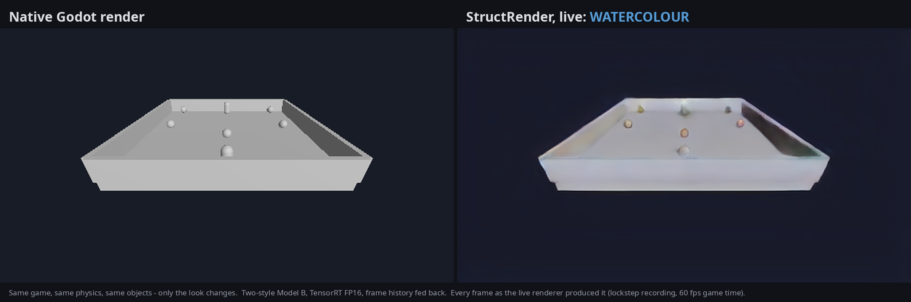
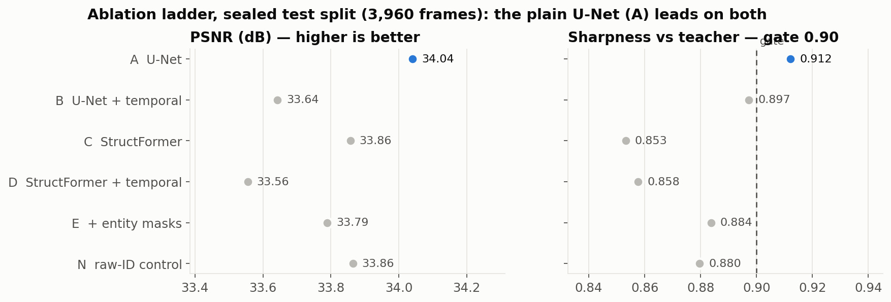
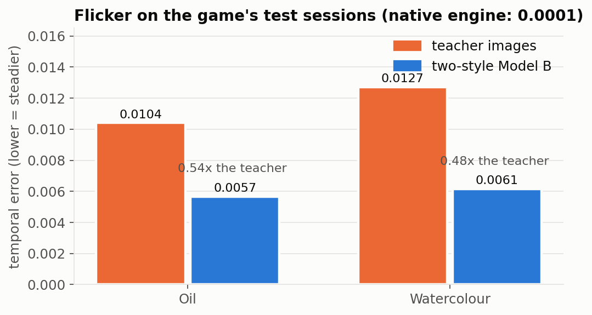
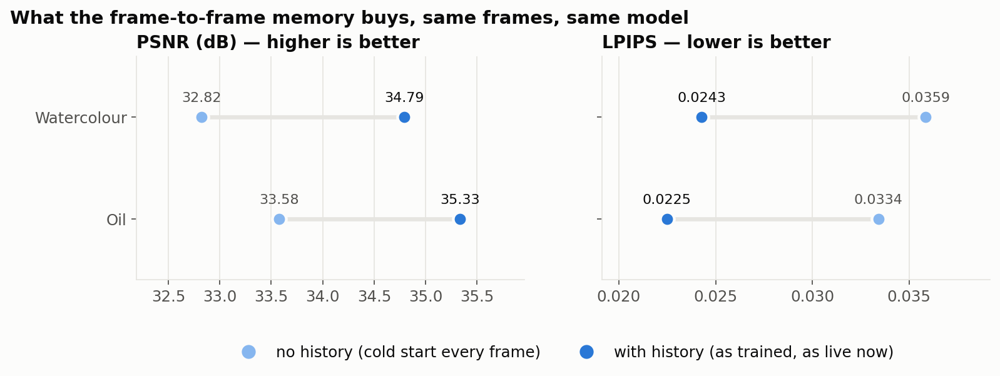
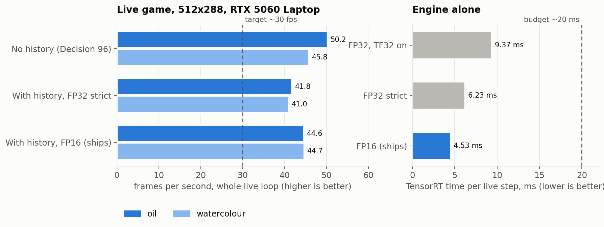

# StructRender — Final Report

*Engine-grounded neural rendering for games: a Godot game, re-rendered live in a learned
painterly style, with the engine — not the network — deciding what exists and where.*

October 2026. Every number below comes from a committed report or log; the Decision
numbers point into the project's Decision Log ([`docs/StructRender_KB.md`](StructRender_KB.md)),
which is the authoritative record and says more than this summary can.

---

## 1. What was built

StructRender takes the **structure** a game engine already knows about each frame —
depth, surface normals, albedo, motion and entity identity — and trains a network to
render that structure in a painted style. A diffusion model (Stable Diffusion 1.5 +
depth ControlNet) is used only **offline** as a teacher to make training targets; the
network that runs in the game is a small, fast image-to-image model.

The engine stays in charge: Godot owns physics, game logic and which entity is which
(Decision 2). The renderer only decides how things *look*. That is why a style can be
switched mid-game without anything in the game changing — and why this is a style
renderer, not a game generator (Decision 70).

**The end result:** the actual playable game (`main.tscn`: a player collecting coins
while an enemy chases) runs live in **oil** or **watercolour**, switchable with a key,
at about **44 fps** on an RTX 5060 Laptop GPU.

[](../eval/reports/demo/structrender_demo.mp4)

*Demo video (16 s): [`eval/reports/demo/structrender_demo.mp4`](../eval/reports/demo/structrender_demo.mp4)
— native render on the left, the live renderer on the right, switching oil ↔ watercolour.
Every right-hand frame is exactly what the live renderer produced; the recording steps the
game one physics tick per frame so recording cannot distort it.*

---

## 2. Headline results

- **Live, two styles, one model.** One network renders both styles; a 16-number style
  vector switches between them. On the game's held-out test sessions: **35.33 dB PSNR
  (oil) and 34.79 dB (watercolour)**, sharpness 0.946 / 0.937 (Decision 95). Sharing the
  model costs oil about 0.1 dB against an oil-only model — one run each, so not claimed
  as real.
- **Steadier than its own teacher.** The renderer flickers about **half as much** as the
  diffusion targets it learned from (0.54x oil, 0.48x watercolour) (Decision 95).
- **The style is genuinely learned.** Each style moves the colours **98-99 %** as far
  from the plain game as the teacher does (gate ≥ 80 %), and beats "do nothing" by
  7.3-7.8 dB (Decision 99).
- **Real time.** 44.6 fps oil / 44.7 fps watercolour live; 4.5 ms per frame for the
  network alone in TensorRT FP16; 3,000 frames with no fallback; renderer failures fall
  back to the plain game image and recover on the next frame (Decision 98).
- **Live = scored.** The live C++ frame matches the evaluated PyTorch model to within
  one colour level in 255, verified link by link (Decision 97).
- **The honest negatives.** The transformer renderer (StructFormer) never beat the
  plain U-Net, even at 32x the data (Decision 71). The protected novelty, persistent
  per-entity appearance memory (EPAM), did not improve output on this data
  (Decision 79). Both are reported as measured.

---

## 3. Milestone scorecard

| | Milestone | Verdict | Evidence |
|---|---|---|---|
| M0 | Repository + minimal Godot game | complete | |
| M1 | Structural export (depth, normal, albedo, motion, entity ID) | complete | D23-26 |
| M2 | Dataset recorder + validator | complete | D27-30 |
| M3 | Offline teacher targets + four alignment gates | complete | D31-34, D40 |
| M4 | CNN / U-Net baseline | **passes** — at every dataset size | D35, D41, D46, D71 |
| M5 | StructFormer (transformer) baseline | **fails** — below the U-Net at 644, 10,890 and 20,790 frames | D49, D71 |
| M6 | Temporal reprojection | **passes** — -11.7 % flicker; replicated -10.7 % on new data | D67, D85 |
| M7 | Structured entity awareness | **complete** — all 3 criteria, asserted by tests | D74 |
| M8 | EPAM (persistent appearance memory) | criteria 1-3 met; **criterion 4 not met** | D78, D79 |
| M9 | Full evaluation (ablation ladder) | **complete** | D83, D85, D89 |
| M10 | ONNX → TensorRT → C++ → Godot | **passes** — all exit criteria | D84, D86, D96-99 |

A failed milestone here means a pre-registered criterion was not met, not that work is
missing; the failures are findings about this data and are kept as such.

---

## 4. The ablation ladder (M5-M9)

Each rung adds one idea, at matched parameter count (0.9-1.1x, Decision 47), same data,
same objective, same stopping rule, scored on 4 sealed test sessions (3,960 frames) by
one scoring path (Decision 83).



- **The plain U-Net (A) wins on image quality**, and is the only rung to clear the 0.90
  sharpness gate. StructFormer (C) was predicted to catch up with more data; at 32x the
  data its sharpness *fell* (0.886 → 0.851), refuting the scaling hypothesis
  (Decision 71). At this scale and parameter count, a windowed transformer underperforms
  a CNN.
- **Temporal conditioning works on both backbones.** Adding the previous frame cuts
  flicker by **15.2 %** on the U-Net (B vs A) and **10.7 %** on StructFormer (D vs C),
  both well past a noise threshold fixed in advance (Decision 85). It costs 1.8-3.9 %
  per-frame L1 — the right trade for a live renderer, where flicker is the more visible
  defect. Model B — the steadiest rung — is the one taken to the game.
- **Entity awareness sharpens, a little.** Over three seeds, E is +0.015 sharper than C
  at 2.5σ, the direction predicted in advance (Decision 77). **But** a naive control
  (N) that feeds the raw entity ID as a number gets about 87 % of that gain
  (Decision 89): on this scene, with only two or three entities, exposing the IDs is
  enough. The structured design is not shown to be necessary here — a scene with many
  entities and recycled IDs would be needed to separate the two.

---

## 5. EPAM — the protected novelty

EPAM (Engine-Keyed Persistent Appearance Memory) keeps a per-entity appearance memory,
keyed by the engine's entity identity, so an object should look the same when it
reappears. It was the project's headline idea, and it was tested cleanly:

- the memory model F and its built-in no-memory twin F0 share code, data, schedule and
  selection rule, differing only in whether memory is on (Decision 78);
- the pass threshold (0.0206 sharpness) was written into the evaluator before the run.

**Result: memory did not help.** F − F0 sharpness is **-0.0127** — inside noise, and
pointing the wrong way (Decision 79). Three independent measurements agree that this
data gives memory nothing to recover: appearance carries no information across an
occlusion gap (correlation ≤ 0.037, Decision 73), the reappearance metric does not
degrade with time unseen (Decision 53), and anchoring the teacher's noise per entity
does not create persistent appearance (Decision 81).

The likeliest reason is the supervision, not the mechanism: the diffusion teacher
re-invents each object's look every frame (its flicker is ~26-32x the engine's), so
there is no stable per-entity appearance in the targets for a memory to hold. Testing
EPAM properly needs a temporally consistent teacher or authored per-entity textures —
outside this project's hardware and scope. EPAM remains session-local as specified
(Decision 11); nothing was added to rescue it.

---

## 6. The playable game

Every ladder model was trained on a scene the recorder builds in code; none had seen the
real game. So the game itself was recorded — 24 sessions of scripted play through the
player's own controls, 23,760 frames (Decision 87) — and a teacher style chosen for it by
the same alignment gates as before (Decision 88).

- **Oil** passed the gates at strength 0.50. The original watercolour failed on the
  game; a bolder watercolour passed at 0.55 (Decisions 90, 92).
- **11 of 23,760 frames** failed a gate in one style. Rather than drop whole sessions —
  which would have cost a held-out test session — those frames, and every training
  sequence touching them, are excluded. The gates themselves were not changed; the rule
  was adopted after seeing the failures, and says so (Decision 94).
- **Two-style Model B** (the U-Net with temporal conditioning) adds a per-style
  modulation to its decoder only. The encoder — and so the frame-to-frame memory — is
  style-free, which is what lets a style switch keep the history. Untrained, it is
  exactly Model B; +0.2 % parameters (Decision 94). Trained 60 epochs, 29 h.

| model, style (2,968 test frames each) | PSNR | SSIM | LPIPS | sharpness | colour travel vs teacher |
|---|---|---|---|---|---|
| two-style B, oil | 35.33 | 0.9807 | 0.0225 | 0.946 | 0.995 |
| two-style B, watercolour | 34.79 | 0.9786 | 0.0243 | 0.937 | 0.987 |
| oil-only B, oil | 35.43 | 0.9814 | 0.0216 | 0.946 | 0.980 |



The style switch is real rather than a blend: each style's output is about **4x closer**
to its own targets than to the other style's, and the two outputs differ by 93 % as much
as the two teachers do (Decision 95).

The styles are deliberately mild: the game is grey and plainly lit, and stronger teacher
settings break the alignment gates (they start inventing edges), so the targets
themselves are subtle.

---

## 7. Live runtime (M10)

The live loop: Godot renders four cheap structure passes → a C++ GDExtension computes
the motion field and the "which pixels can trust history" mask → TensorRT runs one step
of the model, feeding back last frame's features → the frame is shown. If anything fails,
the native frame shows instead and the game never waits (Decisions 86, 96-98).



The first live version ran without frame history and was **~2 dB worse** than the scored
model. Wiring history into the runtime closed that gap. To make sure the live frame *is*
the scored frame, every link was checked:

| link | max difference |
|---|---|
| exported live step vs the Python evaluator | 2.4e-6 |
| TensorRT engine vs PyTorch (strict FP32) | 1.6e-6 |
| C++ motion vs the engine's own GDScript motion, 120 frames | 7.5e-8 |
| live game frame vs scored model | 1/255 (rounding) |
| spawned object mid-game: no-history pixels, C++ vs engine ID map | 998 = 998 |



**FP16** passes an accuracy tolerance fixed before it was measured (mean PSNR change
0.044 dB < 0.05; mean pixel change 0.0004 < 1/255). Its few large pixel differences sit
on one-pixel object outlines — an edge moving by a fraction of a pixel — and are noted
rather than hidden (Decision 98). It is 27 % faster, so it ships.

---

## 8. What this does not show

- **One scene, one game.** All results are on this project's arena scenes. Nothing here
  is evidence about other games or art styles.
- **The teacher's flicker is the ceiling.** The renderer halves the teacher's flicker
  but is still far above the engine's own (about 57x on the game). Temporal conditioning
  narrows that gap; it cannot close it while the targets flicker.
- **Single runs on the game.** Game-level seed variance was never measured, so small
  differences between game models (e.g. oil-only vs two-style, 0.1 dB) are not claimed.
- **Mild styles at low resolution.** 512x288, strength ≈ 0.5 — set by what passes the
  alignment gates on a plain grey game.
- **Live free play is not lockstep.** The 4-pass capture is not paused in free play, so a
  physics tick can occasionally land mid-capture; every equivalence check above was run
  in lockstep.
- **EPAM and structured entity use are untested where they should matter** — scenes with
  many entities, ID recycling, and a temporally consistent teacher.

---

## 9. Reproduce

```bash
# Python environment: /home/kabilash01/miniconda3/envs/dl   (tests: 541 pass)
python -m pytest -q

# Score the game models on the sealed test sessions
python -m scripts.eval_game checkpoints/game_b_two_style/best.pt configs/data/game_split_v1.json \
       oil_impasto eval/reports/game_b_two_style_test_oil.json configs/data/game_frame_exclusions_v1.json
python -m scripts.eval_game_style_acquisition

# Build the live engines for this GPU, then play (1 oil, 2 watercolour, 0 native)
python -m scripts.m10_live_temporal_engines
python -m scripts.m10_fp16_live
SR_ENGINE_OIL=$PWD/artifacts/engines/game_b2_live_oil_impasto_fp16.engine \
SR_ENGINE_WATERCOLOR=$PWD/artifacts/engines/game_b2_live_watercolor_bold_s055_fp16.engine \
godot --path game_project -s res://tests/runtime/live_game.gd

# Demo video and these figures
python -m scripts.make_demo_video        # after game_project/tests/runtime/demo_record.gd
python -m scripts.make_report_figures
```

Weights: GitHub releases `game-v1` (the game models) and `ladder-v3` (ladder rungs A, C, E).

---

## 10. Evidence index

| claim | file |
|---|---|
| ablation ladder | `eval/reports/m9_ladder.json`, `eval/reports/m9_temporal_error.json` |
| StructFormer scaling | `eval/reports/ladder_v3_test.json` |
| EPAM F vs F0 | `eval/reports/m8_f_vs_f0.json` |
| game test results | `eval/reports/game_b_two_style_test_{oil,watercolor}.json`, `game_b_oil_test_d94frames.json` |
| without history | `eval/reports/game_b_two_style_test_*_nohistory.json` |
| style acquisition | `eval/reports/game_style_acquisition.json` |
| frame exclusions | `configs/data/game_frame_exclusions_v1.json` |
| live equivalence | `eval/reports/m10_live_temporal_engines.json`, `m10_live_temporal_parity.json`, `eval/logs/m10_live_temporal_parity.log`, `eval/logs/m10_spawn_parity.log` |
| FP16 | `eval/reports/m10_fp16_live.json` |
| live speed, stability, failures | `eval/logs/m10_final/` |
| demo | `eval/reports/demo/` |
